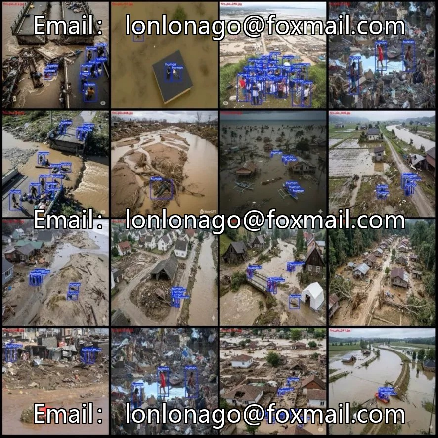
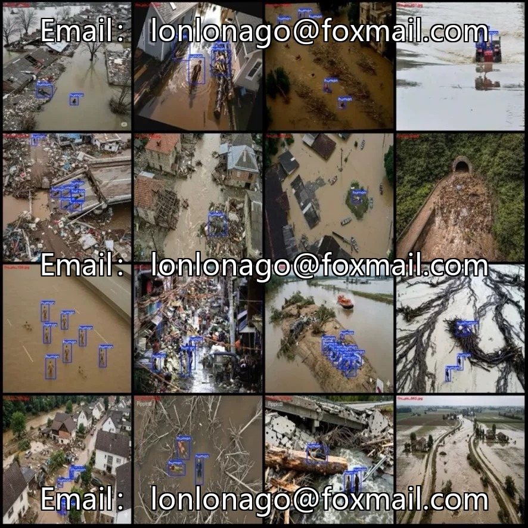
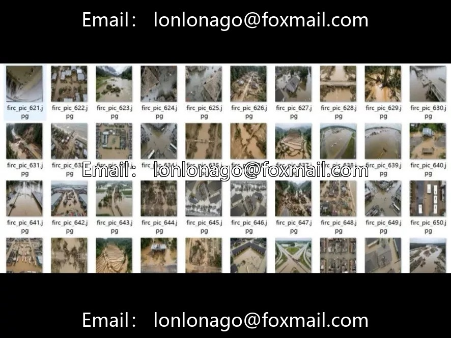

# Drone flood disaster rescue personnel detection dataset

## Body

Drone Flood Rescue Personnel Detection Dataset for Drones - 670 aerial photos of drones, 1024x1024 resolution, single-category "human", with 3886 person bounding boxes labeled, fully dense. Suitable for post-disaster search and rescue, rescue dispatch, personnel distribution assessment, etc.

The dataset is not divided into training/validation/test sets. It is recommended to allocate it according to an 8:1:1 ratio yourself. For single-class detection, the grounding scenarios are clear, and the model training is friendly.

Virtual materials, once sold, are non-refundable.
Interested friends, click "I want" to proceed.

## Images

## Payment

Here is a pay link on Stripe ( https://buy.stripe.com/3cs8yP7sY87d0vu9AB ). Please contact me lonlonago@foxmail.com after funding $89, and I will send you a complete data files , thank you!

